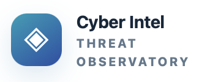
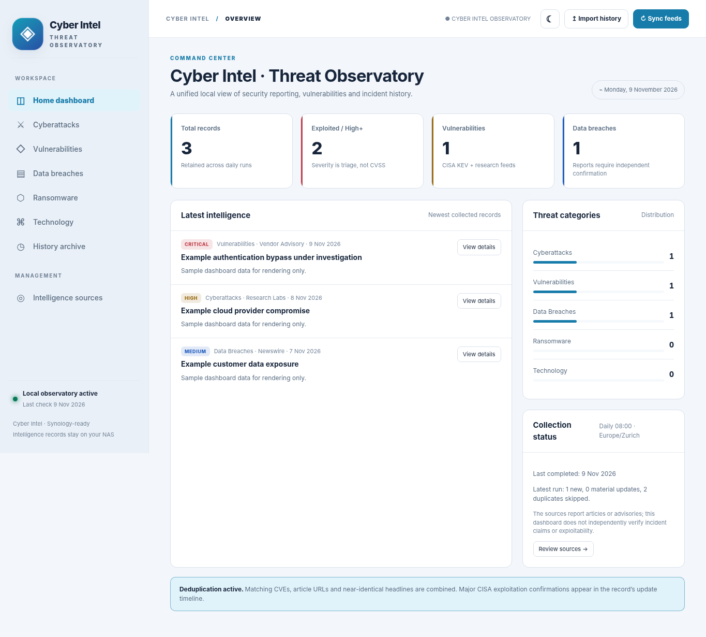
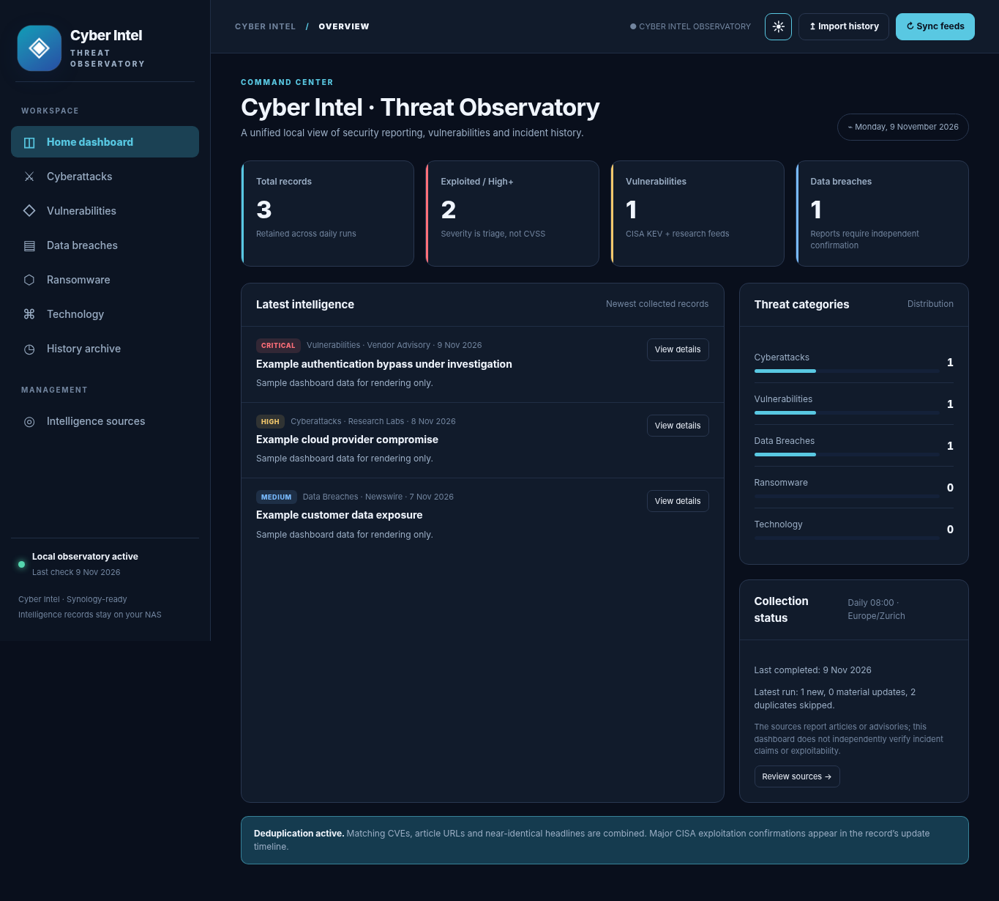

# Cyber Intel — Threat Observatory



**Public source repository · Synology NAS Docker edition**

A self-hosted cybersecurity intelligence dashboard with a permanent SQLite archive, category tabs, detailed incident timelines, feed status monitoring, CVE-based deduplication, JSON/CSV export, and readable dark/light modes.

## Interface preview

These screenshots show the Cyber Intel branding with **illustrative demonstration records**, not verified incident alerts.

| Light mode | Dark mode |
| --- | --- |
|  |  |

**Scope:** A working RSS and public-data **aggregator** (not a full commercial threat-intelligence platform or confirmed incident database). News headlines are source-attributed and may describe **unverified** claims. Risk severity is an editorial triage estimate, **not a CVSS score**. The app never claims that you are vulnerable without asset/environment verification.

## What is automatically ingested

- **CISA Known Exploited Vulnerabilities (KEV):** official JSON, with official GitHub mirror fallback; only recent additions. Exploitation state is distinguished from CVSS. CISA additions can become a material update to an existing CVE record.
- **CERT-FR:** French alerts, threats and selected high-impact advisories through public RSS feeds.
- **SANS Internet Storm Center:** Handler's Diary RSS.
- **watchTowr Labs:** research RSS feed (`https://labs.watchtowr.com/rss/`).
- **BleepingComputer, SecurityWeek, The Record, Krebs on Security:** public news RSS feeds.
- **FIRST EPSS:** best-effort enrichment for newly collected CVEs through the free API, shown as probability, never severity.

**Link-only sources:** `https://watchtowr.com/intelligence/` (the portal itself), Cloudflare Radar, GreyNoise, Ransomware.live, NCSC Switzerland, ENISA. These are visible from the Sources tab but are **not automatically scraped**. RSS feeds can become unavailable or change; the Sources tab shows failures. The app never silently treats a source failure as "no threats".

## Synology installation (DS723+ or compatible)
[Synology DSM 7 Installation Guide](SYNOLOGY_INSTALLATION.md)

## Synology installation (DS723+ or compatible)

1. Unzip the project into `/volume1/docker/sentinel-cyber-intel-threat-observatory/` (or another shared folder). You should see `docker-compose.yml`, `Dockerfile`, the `app/` folder and `data/`.
2. From an SSH session on Synology, go to the project folder:

   ```bash
   cd /volume1/docker/sentinel-cyber-intel-threat-observatory
   ```

3. To override the Compose defaults, create `.env` beside `docker-compose.yml`. Set `BIND_IP` to your NAS LAN IP and set `WEB_PORT` if port `8791` is already in use.
4. Set `CTI_UID` and `CTI_GID` to match a NAS account that can write to `data/`, or grant access to the default container account. See [persistent data folder and permissions](SYNOLOGY_INSTALLATION.md#5-create-the-persistent-data-folder-and-permissions).

5. Start the containers (Docker Compose v2):

   ```bash
   sudo docker compose up -d --build
   sudo docker compose ps
   ```

6. Open **http://NAS-LAN-IP:8791** from a browser on your local network.
7. The first collection starts automatically. You can also click **Sync feeds**. Feed errors and the actual last-check time are visible under **Intelligence sources**.
8. Go to **History** and click **View details** for a complete record, original sources and material update history. The **Import history** button accepts exports from your earlier offline HTML dashboard.

If Synology Container Manager's Projects interface does not build local Dockerfiles on your installed version, build/start once with the SSH commands above, then manage the running container through Container Manager.

### Persistent storage

- All incident data is in `data/cti.db` (plus `cti.db-wal` and `cti.db-shm` while running).
- The archive **does not disappear when your browser cache is cleared**.
- To make a consistent offline backup, stop the container or use SQLite's online backup command before copying the database file. A simple safe path is `sudo docker compose stop`, copy the `data/` folder, then `sudo docker compose start`.
- Export all incidents with **History > CSV** or **API JSON** at `/api/export.json`.
- Your previous HTML archive can be imported using **Import history**. For a public release, `legacy_history.json` is provided separately rather than included in GitHub because its historic records were not independently verified. Importing it is optional.

### Schedule

Open **Collection settings** in the dashboard to set a recurring refresh from **1 minute to 24 hours**. The default remains a daily refresh at **08:00 Europe/Zurich**, with a collection at startup. **Sync feeds** runs an immediate refresh. The interval is saved in SQLite.

### Source editing, sharing and alerts

- In **Intelligence sources**, add, edit, disable or remove public RSS and Atom feeds. Research links can be added, edited or removed separately. CISA KEV and FIRST EPSS have enable switches and use their built-in endpoints. Source edits apply to the next refresh and preserve archived records.
- **New findings** shows a badge for new records and material updates. Each browser tracks what its user has marked as seen. The first visit starts with the current archive as the baseline.
- **View details** provides **Copy summary** and **Email draft**. On browsers that support the system share sheet, **Share…** opens it.
- In **View details**, choose **Add to favorites** and enter tags such as `crypto` or `PHP`. Open **Favorites** to search saved records or filter them by tag. Favorites and tags are stored in SQLite and shared across browsers on the same installation.
- To receive a digest after refreshes with new activity, [configure SMTP on the NAS](SYNOLOGY_INSTALLATION.md#email-digests) and enable email in **Collection settings**.

### Runtime security (even with a public GitHub repository)

- Anyone who can reach the service can view and export the archive or call the API. Keep the service on a trusted private network. For remote access, use a private VPN or an authenticated HTTPS reverse proxy.
- The container is non-root, read-only apart from the volume and tmpfs, and drops Linux capabilities.
- The UI renders external feed content as text and validates outgoing links. Import/sync requests require a custom same-origin header.

### What deduplication does

- Exact CVE match for one-CVE vulnerability stories.
- Canonical URL match, ignoring tracking parameters.
- Conservative fuzzy matching for nearly identical headlines within the same category.
- Already-seen feed articles do not generate a second record. A newly verified CISA KEV exploitation confirmation is recorded as a **material update** to an existing vulnerability.
- Historical records remain in SQLite; this app does not write back to your previously downloaded standalone HTML files or alter your separate ChatGPT monitoring automation.

### Limitations and next features

This MVP is an online-powered, regularly refreshed **feed aggregation dashboard** and historic source database. It does **not** guarantee every cyberattack worldwide is detected, and does not yet include complete victim attribution, full CVSS/affected-version enrichment, vulnerability-to-asset mapping, commercial feeds, webhook/push alerts, AI incident summaries, or a real-time attack map. The "Ransomware" tab collects publicly published ransomware coverage, not unverified criminal leak-site claims.

### Developer tests

Run from the project folder with Python 3.12+:

```bash
pip install -r requirements.txt pytest
PYTHONPATH=. pytest -q
```

## Public GitHub repository

Repository: **https://github.com/Kibo28/sentinel-cyber-intel-threat-observatory** (public).

Copy this package's **contents** into your local GitHub Desktop working tree at:

`/Users/kibo/Documents/GitHub/sentinel-cyber-intel-threat-observatory`

In GitHub Desktop, review the files in **Changes**, commit them to `main`, and click **Push origin**. Confirm the GitHub website shows `README.md`, `Dockerfile`, `docker-compose.yml`, `app/`, and `tests/`. Do **not** commit `.env`, SQLite databases, API credentials or historic private exports.

The `.github/workflows/tests.yml` workflow checks the Python application when you push. GitHub visibility is public but the Synology-hosted runtime and its database should stay private. No license has yet been selected; if you want third-party reuse, add a license after deciding the terms.

**Deployment**: see [SYNOLOGY_DEPLOYMENT.md](SYNOLOGY_DEPLOYMENT.md) for a tested-by-inspection, step-by-step procedure (the Docker image itself still needs validation on your NAS).

### Update the app from the GitHub repository on Synology

To update from the dashboard after a one-time NAS setup, enable **App updates** in the [Synology installation guide](SYNOLOGY_INSTALLATION.md#enable-the-app-updates-button).

Clone the repository on your Synology NAS (via SSH) to a new folder. Create a local `.env` if you need to override the Compose defaults. For subsequent updates, back up `data/` first, and run:

```bash
git pull --ff-only
sudo docker compose up -d --build
```

If you already have a deployment with valuable incident history, **do not overwrite its `data/` folder**: preserve the SQLite archive and `.env` separately when switching to a Git-based deployment.
